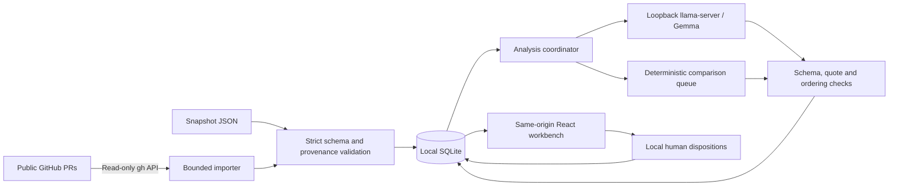

# ReviewRadar technical requirements

Planning baseline · 23 October 2026 · subject to the stage-zero contract audit. This document specifies intended behavior; it does not certify implementation or completed tests.

## 1. Architecture and product boundary

ReviewRadar is a local, single-user application for finding individual **human-reviewer** requests in selected public pull-request discussions and placing possible later author responses beside the original evidence. Its v1 queue has explicit `human_review` scope: all bot material remains visible in Sources, with exclusions counted. It does not inspect a patch to prove a defect fixed, infer whether a maintainer is satisfied, or write to GitHub.

Use React, TypeScript and Vite for the interface; Python 3.12, FastAPI and SQLite for the backend. The backend serves the built frontend so the release has one loopback origin. A development proxy may forward `/api` and runtime configuration to that backend. No production dependency on a Vite development server. No cloud inference, browser GitHub token, background polling of other people's repositories, or private-repository support in v1.

Public hosting serves an explicitly labeled **historical sample replay**, not a remote instance of the local app. The same workbench components consume a static adapter in replay and the API adapter locally. Replay cannot import a visitor's data, run inference, or persist a global user's decisions. Its sample date and model run provenance stay visible.

## 2. Data contracts and coverage

`00-DECISIONS-AND-CONTRACT.md` is the wire-schema authority. Validate every import and stored model response using strict schemas; reject unknown fields and oversized values. Use stable source IDs rather than position indexes. Snapshot identity is a SHA-256 of canonical serialized data excluding its own `id`; recompute it on import. Retain fetched timestamps, original comment bodies and original public URLs.

Required audit amendment: each analysis has `scope: "human_review"` and records a coverage item for **every selected PR**, with `pr_id`, status (`analyzed`, `failed`, `rejected_oversize`), processed and total comment counts, `comments_excluded_bots`, and a specific warning where applicable. Aggregate statistics also record `comments_excluded_bots`. `comments_total` counts all source comments, while `comments_processed` counts fully processed non-bot comments, including author updates supplied as response context. Excluded bots must not inflate the processed count. Top-level `complete` is true only when every selected PR and validated output succeeded within the declared human-review scope; the persistent scope label and excluded counts prevent that from suggesting bots were analyzed. An empty card list is not a clean queue when intake or analysis is incomplete. Already persisted complete results survive a later failed analysis attempt.

Separate three statements in storage and display:

| Statement | Source | Permitted conclusion |
|---|---|---|
| Thread resolved, review approved, PR merged | GitHub metadata | GitHub reported that state at fetch time |
| A later response may address this request | Model interpretation with two source quotes | Human should inspect the pair |
| Reviewed or reopened in this workspace | User disposition | Local user's organization decision only |

Use `null` for unknown thread state. Never convert absent metadata into false. An old changes-requested review can coexist with a later approval; neither should erase the original request or establish its implementation was correct. New analysis IDs do not silently inherit reviewed decisions onto changed evidence. Initially implement `open` and `reviewed`; defer time-based snoozing unless its behavior and expiry can be tested.

## 3. Intake

1. Accept one to five canonical `https://github.com/OWNER/REPO/pull/NUMBER` URLs and one explicit author login. Normalize duplicates before fetch. Reject userinfo, ports, query strings, arbitrary hosts, non-PR paths and redirects to other resources.
2. Use `gh api` through an argument array, never a shell. Queries and repository variables are developer-owned. No user command, arbitrary API path, or GraphQL mutation is accepted.
3. Check public repository visibility and exact PR author match. The typed owner is a scope filter, not identity verification; label it as such. Do not import private content even when the existing CLI session can read it.
4. Fetch issue comments, review summaries, inline comments and thread metadata. Paginate every connection independently, including comments nested inside review threads. Detect `hasNextPage`, partial GraphQL errors and endpoint failure. A bounded first-page result must never be called complete.
5. Preserve comment authors and bot type from GitHub where available. A deleted account is an unknown author, not the PR author. Bot filtering affects the human-review suggestion queue, not raw evidence preservation. Show a persistent human-review scope label and the exact bot exclusion count, with access to every excluded comment in Sources; no assertion about bot requests follows from a complete human-review run.
6. Use a bounded overall import deadline, page/byte caps and sequential requests. On rate limits, stop with actionable retry guidance; do not repeatedly retry. Partial intake may be stored with warnings and available for evidence viewing, but cannot produce a fully complete analysis.

Initial safety limits should live in one backend settings module: five PRs, 200 comments per PR, 20,000 characters per comment, 2 MiB request body and a 60-second intake budget. These are intended upper bounds, not a promise that all inputs fit the model. A cap reached before exhaustion sets incomplete state. Do not alter original bodies to make them fit.

## 4. Inference and the baseline

Pin the model artifact, revision, SHA-256, runtime revision, context size and prompt version in a manifest. Reuse an existing verified artifact for local development without copying another project's source. Record the actual runtime used by each saved evaluation. The model service is a separate loopback process on a project-owned port; never stop or reuse another application's authenticated server by reading its credentials.

The isolated local runtime has been probed with a 16,384-token context on this development machine; keep that value configurable and record the actual configured context in each run. This is not a hardware-independent performance promise. Before generation, apply the runtime's chat template, then tokenize the rendered prompt using its tokenizer. Reserve 2,048 generated tokens and 1,024 tokens of safety margin: the initial maximum rendered input is 13,312 tokens on this configuration. Reject a configuration whose reserves consume its whole context. If exact chat tokenization is not available, use a conservative UTF-8-byte bound with an explicit safety margin and record that method; character-count estimates must not imply an exact token count. Disable context shifting/truncation where supported and reject an over-budget PR. A tokenizer failure also fails that PR. Keep its raw evidence visible and explain the limit.

**Do not ship untested arbitrary chunking.** Requests and responses may sit far apart; naive chunks can turn a real reply into a false reminder. A later upgrade may use separately evaluated request extraction and cross-batch response retrieval, but requires explicit coverage accounting and a PR-level evaluation of cross-chunk cases. v1's complete-or-reject per-PR model call is a defensible bounded release.

Send each eligible complete PR as structured JSON data under an explicit system policy. Separate eligible non-bot, non-author reviewer comments from non-bot author comments supplied only as possible response context. Preserve each record's identity and date; author updates cannot become requests, and bots are excluded explicitly rather than silently cropped. Source text is untrusted discussion, not instructions. Ask for a bounded JSON result using the runtime's schema-constrained response mode where supported; retain strict independent validation because constrained shape does not prove semantic accuracy. Use a deterministic temperature, bounded generated tokens and a per-call deadline. Queue at most one analysis job in the local process to avoid duplicate slow calls; return a visible busy response rather than silently starting extra jobs. Do not label transient unavailability as no requests found.

Every candidate must pass all of these checks:

- Request and response IDs belong to this PR and snapshot; request body is nonempty and the author is not the selected PR author or a known bot.
- Both quotes are nonempty exact substrings of their referenced original bodies, with bounded length. Repeated identical quotes remain identified by source ID.
- A response comes from the PR author and is strictly later than the request. Equal timestamps do not prove causality. Same-thread context is helpful evidence but does not prove satisfaction.
- Category and interpretation are allowed values. `possibly_responded` requires a valid response; a missing or invalid source fails the PR result rather than disappearing silently.
- Source links are looked up from validated snapshot records. Model output has no URL, command or filesystem-path authority.
- Rationale and uncertainty are bounded plain text. Duplicate identical request-span cards are rejected or normalized deterministically with an explicit rule.

The deterministic baseline is deliberately modest: show every nonempty, non-bot, non-author human comment as a **comment to inspect**, with its original metadata; optionally show chronologically later author comments as unranked nearby evidence. Retain the same persistent human-review scope and bot exclusion counts as model mode. It must not call all comments actionable requests or imply semantic response matching. Compare it as an honest no-model workflow. Use separate mode labeling and never silently fall back from model to baseline.

## 5. Persistence and API behavior

SQLite stores immutable snapshot and analysis JSON plus a separate disposition table keyed by analysis/card ID. Use parameterized SQL, foreign-key checks and short transactions. Heavy network/model work runs outside write transactions. Validate a complete analysis before committing; partial failures have explicit coverage records. Database files and logs stay ignored by Git. Provide documented delete-local-data steps and export limitations; add per-snapshot deletion only if it includes dependent results atomically.

API endpoints follow the draft contract. Every mutation requires JSON content type, the local session token and an exact approved browser Origin; command-line clients must explicitly send the expected Origin. All data-reading APIs require the session token too. Health contains no source content or secret. Fetches use an AbortController in the UI; cancelling a browser request is not advertised as stopping an already running server operation. Use `409` for an existing running job, `413` for body/size limits and an explicit error message for other validation failures. Do not return raw subprocess stderr, credentials or local paths to the browser.

Markdown export contains snapshot date, model/baseline label, completeness warnings, original source links, human disposition and the limitation that a response is not a verified fix. Escape text so source bodies cannot create forged export headings or links. Exports are local downloads, never automatic uploads.

## 6. Review gates

| Gate | Required evidence |
|---|---|
| Intake | Authorship/public checks; nested-pagination cap fixture; rate-limit and partial-error behavior; URL rejection tests |
| Model | Real local inference; bad JSON/quote/ID/order/timeout cases; oversized-input rejection; no silent baseline fallback |
| Persistence | Restart preserves results and decisions; missing record errors; immutable previous analysis after failure |
| Interface | Keyboard source navigation; visible coverage; mobile layout; reduced motion; failure and empty states |
| Release | Clean install path; exact dependency/model provenance; public replay is labeled; no secrets or weights in tracked files |

Evaluation requirements are defined in `04-EVALUATION-PLAN.md`; security requirements in `05-SECURITY-PRIVACY.md`. Report limitations rather than widening the product promise to fit the submission.

## Primary references checked

- [GitHub GraphQL rate and query limits](https://docs.github.com/en/graphql/overview/rate-limits-and-query-limits-for-the-graphql-api): the API has bounded resources and can return partial failures; importer limits must be explicit.
- [Pinned llama.cpp server documentation](https://github.com/ggml-org/llama.cpp/blob/98801578818b26d833a1fe244870d64b0c34bb46/tools/server/README.md): compatible inference routes, tokenization and constrained-response facilities must be checked against the pinned build rather than an assumed hosted API.
- [Starlette middleware](https://starlette.dev/middleware/): use host checks and deliberately configured request middleware. Exact project policy is defined here, not supplied automatically by a framework.
